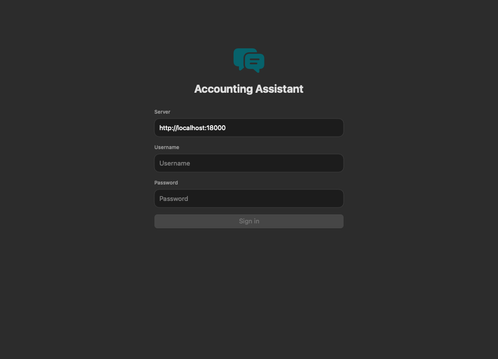
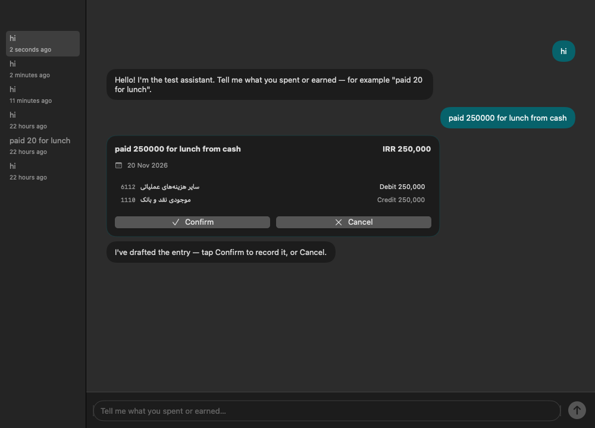
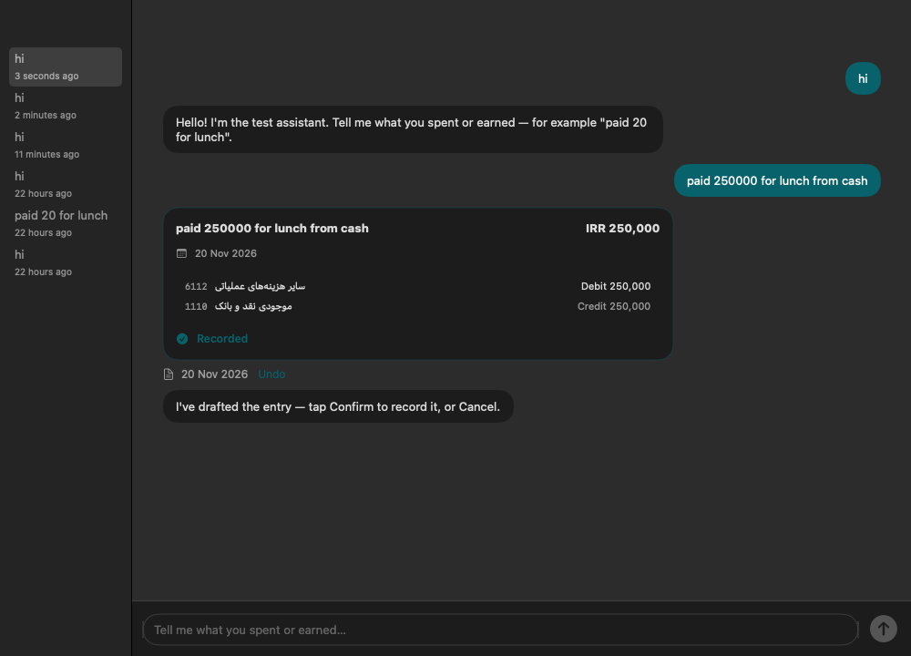
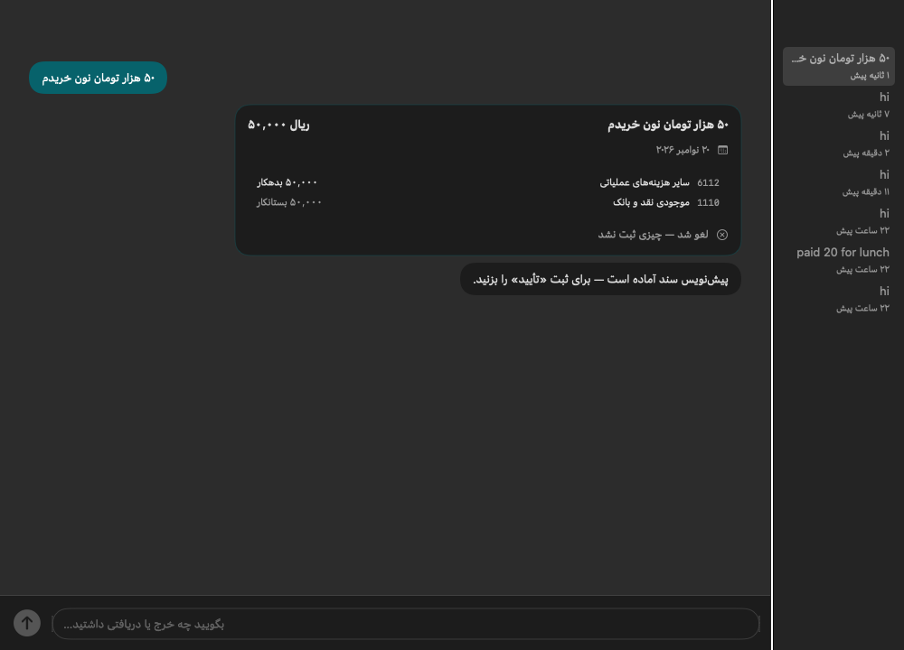
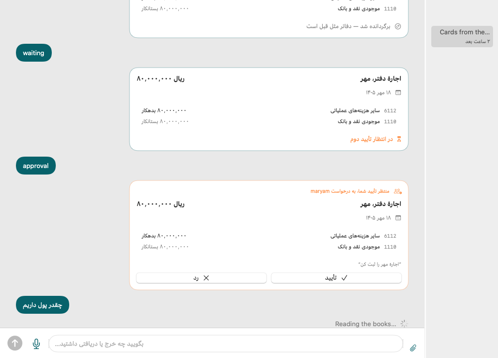
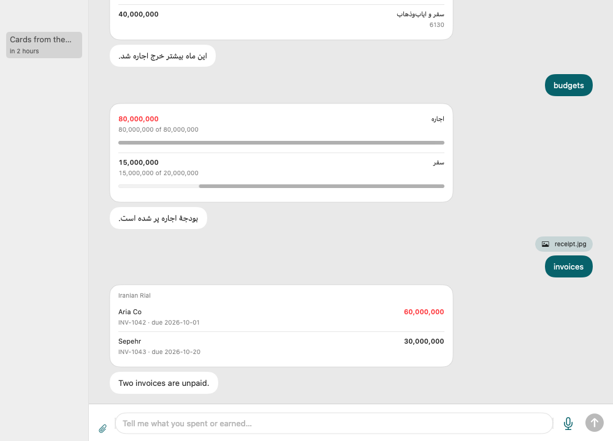
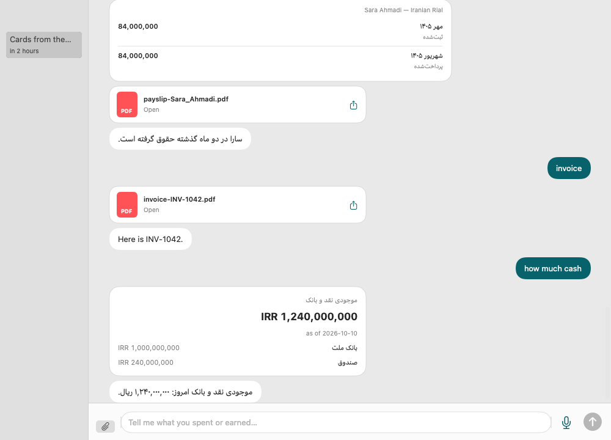

# Accounting Chat — iPhone, iPad and Mac

The assistant's chat as a native app, and nothing else: sign in, the conversations, and the chat with its cards.
It is the same assistant as the web chat, the Android app and the Telegram/Bale bot. Nothing is recorded until
Confirm.

- **Sign-in:** username and password, with two-factor when it's on. It's the phone sign-in
  (`/api/mobile/v1/auth/…`), and the session shows under the user's devices as an iPhone (`ios`), an iPad
  (`ipados`) or the Mac by its name (`macos`).
- **Conversations:** a sidebar on the Mac and iPad, a list on the iPhone. "New conversation" starts one. A
  conversation opens on its latest 60 messages; scrolling to the top brings the page before ("Earlier messages"),
  and the reader stays where they were.
- **Answers:** every kind of the blocks contract (`docs/contracts/mobile-blocks.schema.json`) is drawn:
  - text;
  - a **proposal** with Confirm / Cancel, then "Recorded" with **Undo** for its two minutes. Opened again later, a
    card says where it stands now, in words: recorded (with its voucher and date), undone, cancelled, rejected,
    waiting for a second approval, expired, changed — never the server's own word;
  - an **approval** (someone's voucher above the company's threshold): who asked, **Approve** / **Reject** with an
    optional reason, or **Withdraw** for one's own. The toolbar's **Approvals** lists all that wait. A Confirm above
    the threshold says it waits for a second approval;
  - a **figure** (cash, what's owed) with its breakdown;
  - a **table**: spending, invoices (overdue in red, due date), budgets (bar, "x of y"), pay runs, an employee's pay,
    holdings (what today's rate adds). One currency is named once above; several, on each row;
  - a **chart** (forecast, net worth);
  - a **document** (an invoice's PDF, a payslip): fetched with the session, opened in Quick Look, shared with the
    share sheet;
  - a statement's **intake**, and the week's or the month's **review**.

  A kind added later shows its `fallback_text`, which the contract guarantees reads well.
- **Sending:** the reply is streamed (`/chat/stream`): the step the server is on ("Reading the books…") shows while
  it works. A stream cut short is asked once more over `/chat` with the same message id.
- **Files:** a photo (a HEIC photo goes as a JPEG) or a PDF, CSV or Excel file goes with a message: uploaded in
  pieces of up to 1 MB that grow on a fast line (`/uploads/begin`, `PUT /uploads/{id}?offset=`), going on from
  where the server stands after a dropped connection; its id goes with the words as `attachment_ids`.
- **Voice:** hold the microphone to talk; let go and the words (`/transcribe`) go into the composer to check.
- **Too old:** a server that refuses this version (426) gets a screen saying to update, in the user's language.
- **Language:** English, Persian, Arabic and Spanish, following the user's own setting on the server. Persian and
  Arabic are right to left, and a Persian message reads right to left in an English app too.
- **Network:** https only, plus `http://localhost` for a test server. The tokens live in the Keychain (this device
  only). An expired access token is renewed once and the request repeated. A refused renewal goes back to sign-in.
- **A message sent twice is answered once:** each message carries its own id, so "Try again" after a dropped
  connection never posts twice.

Not here yet (the Android app has them): the outbox that sends by itself after the app is closed, the camera,
editing a card, replying to a message, the morning briefing, bank SMS, the widget and notifications.

## Layout

| path | what |
|------|------|
| `ChatKit/` | A Swift package holding the whole app. `ChatCore` is the API client, the session, the chat's state and its words, with no UI, so `swift test` runs it on any Mac. `ChatKit` is the SwiftUI screens on top. |
| `AccountingChat/` | The app's entry point, icon, and the debug-only scripted run (`Automation.swift`). |
| `AccountingChat.xcodeproj` | One multiplatform target (iOS 17+, macOS 14+), bundle id `app.accountingassistant.chat`. |

## Build and test

**Without Xcode** — the Command Line Tools are enough for the Mac app and every test:

```bash
apple/test.sh                           # 60 tests (Swift Testing): the client, the chat's state, the contract recordings
apple/build-mac.sh                      # → apple/build/AccountingChat.app, signed to run on this Mac
open apple/build/AccountingChat.app
```

**With Xcode** (needed for the iPhone/iPad app, and to sign for other Macs):

```bash
xcodebuild -project apple/AccountingChat.xcodeproj -scheme AccountingChat \
  -destination 'platform=iOS Simulator,name=iPhone 17' build
xcodebuild -project apple/AccountingChat.xcodeproj -scheme AccountingChat -destination 'platform=macOS' build
```

On a phone: open the project in Xcode, choose your team under Signing & Capabilities, run.

Two things keep the no-Xcode build working — keep them so:
- **No `@State`** in the screens: SwiftUI's `@State` is a macro whose plugin ships only with Xcode. The screens keep
  their few switches in small `ObservableObject`s (`LoginFields`, `ChatScreenState`, `ComposerState`, `CardPrompts`).
- **No `defaultLocalization`** in Package.swift: with the Command Line Tools it stops the Swift Testing macros from
  loading. The app's words are in code (`L10n`), not in `.lproj` folders.

`apple/test.sh` is `swift test` that also copes with a Command Line Tools fault: now and then their build system
can't load the testing macros, at random from one build to the next. Only that failure is retried. `build-mac.sh`
builds in its own folder (`apple/build/swiftpm`), because building the app where the tests build makes that fault
far likelier.

The Xcode project is generated by `apple/scripts/gen_pbxproj.py` (one multiplatform target: its sources are the
package's `AccountingChatApp` folder, its resources `AccountingChat/`; the microphone and photo-library usage
descriptions, and on the Mac the sandbox's microphone and user-chosen-files rights, are its build settings).
`.github/workflows/apple.yml` runs the tests,
the no-Xcode Mac build and both Xcode builds when `apple/`, the contract or the workflow changes.

## Screenshots and an end-to-end run

Against a local server (the dev stack on `localhost:18000`) with `tests_e2e/fake_llm.py` standing in for the AI.
A debug build runs a script from its launch environment — signs in, opens the latest conversation (`AC_OPEN=1`) and
its page before, sends (a shot while the streamed answer is under way), confirms or cancels the first card — and
saves its own window after each step (no screen-recording permission needed):

```bash
apple/build-mac.sh debug
AC_SERVER=http://localhost:18000 AC_USER=admin AC_PASS=… AC_SEND="hi|paid 20 for lunch" AC_CONFIRM=1 \
AC_SNAPSHOT_DIR=/tmp/shots apple/build/AccountingChat.app/Contents/MacOS/AccountingChat
```

On the iPhone: run it in the Simulator and sign in to `http://localhost:18000`.

| | |
|---|---|
|  |  |
| Sign in | "paid 250000 for lunch from cash": a card with Confirm / Cancel |
|  |  |
| Confirm: recorded, with Undo for two minutes | A Persian user: right to left; Cancel saves nothing |
|  |  |
| Opened again: undone, waiting for a second approval, an approval to decide; the streamed answer's step | Budgets and invoices as tables; a message sent with a photo |
|  | |
| An employee's pay, a payslip and an invoice's PDF to open or share | |

Shots 5–7 were served from the contract recordings (`docs/contracts/conversations/`) by a stand-in for the server.
