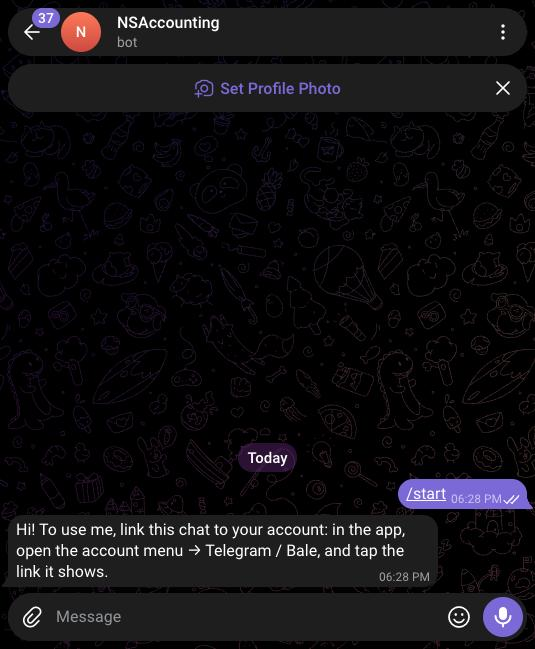
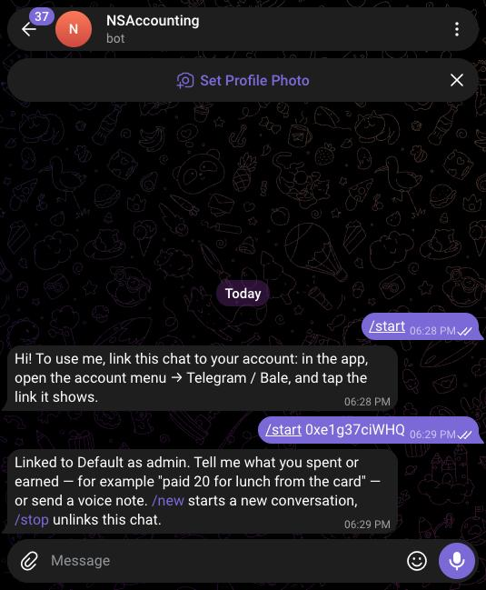
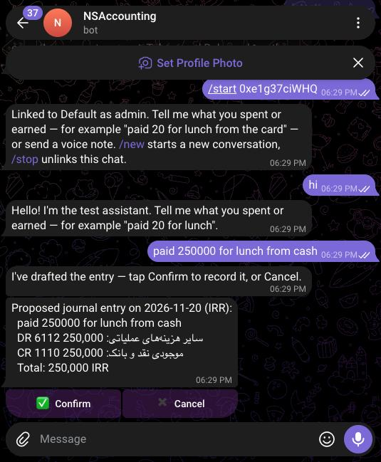
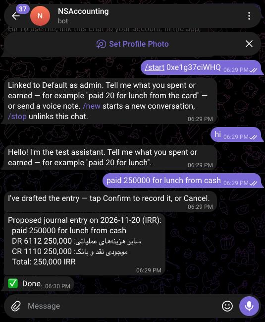
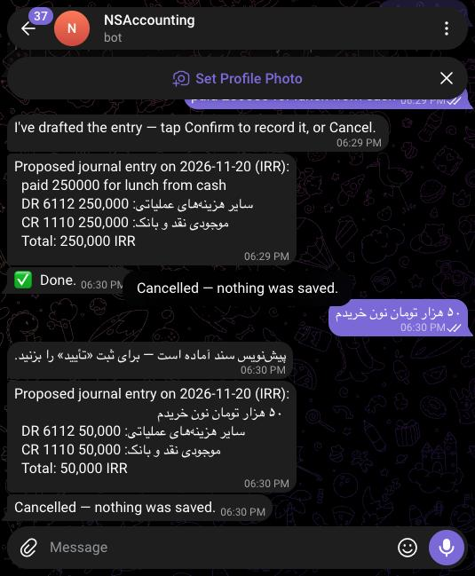

# Telegram relay

Production can't reach Telegram, which is filtered where the server runs. So the bot's Telegram side runs here, on
a machine that can. [DEPLOY.md §14](../../DEPLOY.md) has the whole picture; this folder is the relay.

The relay polls Telegram for the bot's messages and hands each one to the server (`/bots/telegram/relay/update`,
with the relay key), then sends the server's replies back to Telegram. The bot itself stays on the server: signing
in (or making an account) in the chat, linking a chat from the app, the same assistant as the web chat, voice notes,
photos and files, documents sent back, and Confirm / Cancel. The bot token lives only here. The server keeps only
the relay key's hash.

## Set it up

1. **Bot:** in Telegram, message @BotFather, send `/newbot`, and keep the token it gives you.
2. **Relay key:** in the app, as the platform admin, go to Settings → Messenger bots → Telegram → **Use a relay**,
   and copy the key it shows. It is shown only once.
3. **On the machine that will run the relay** (it must reach both api.telegram.org and the app), outside the
   repository:
   ```bash
   cp -R ops/telegram-relay ~/telegram-relay && cd ~/telegram-relay
   cp token.env.example token.env && chmod 600 token.env   # TELEGRAM_BOT_TOKEN
   cp .env.example .env && chmod 600 .env                   # APP_URL, RELAY_KEY
   docker compose up -d --build
   docker compose logs -f relay                 # "relaying @YourBot to https://…"
   ```
   The token has a file of its own because the watchdog (`ops/watchdog`) reads it to send its alerts, and has no
   business with the relay key.
4. In the app's settings the bot now reads "Connected through the relay as @YourBot". People sign in in the chat
   (`/login`, or `/signup` when the server allows sign-up), or link their chat from the account menu → Telegram.

**Updating:** copy the new `relay.py` (and `Dockerfile`, `compose.yml`) over the old ones, then
`docker compose up -d --build`. Update the server first: a new relay sends files as a multipart form, which servers
from before 2026-11-28 don't read.

## How it behaves

- **On start:** it removes any webhook the bot had (Telegram allows getUpdates or a webhook, not both) and checks in
  with the server. It checks in again every 10 minutes; the settings page shows when it was last seen.
- **While the server works:** the chat shows "typing…".
- **Order:** one chat's messages are handled in order; different chats at the same time.
- **Voice notes, photos and files:** fetched here (voice notes up to 10 MB, photos and files up to 20 MB) and sent
  along with the update; the server can't fetch them itself.
- **Documents back:** an invoice's PDF, the journal's Excel or a close pack the server answers with comes with its
  bytes, and is uploaded to the chat from here.
- **Restarts:** the offset of the last update handled is kept in `state/`, so a restart neither loses nor repeats
  updates. The server also ignores an update it has already handled.
- **The server not answering:** each update is tried three times; then the round stops without moving the offset,
  and the same updates are sent again on the next round (the server skips any it had already handled). Nothing is
  dropped while the server is down.
- **Logs:** the token is never written; httpx's request lines show `<token>` instead.

## When something's wrong

- **`the server doesn't know this relay key`:** relay mode was turned off, or a new key was made. Put the current
  key in `.env`, then run `docker compose up -d`.
- **Files don't arrive, or the server answers 422:** the server is older than the relay; update the server first.
- **`Conflict: terminated by other getUpdates request`:** another program is polling the same bot. Only one relay
  may run per bot.
- **No replies, and no errors in the log:** check that the bot's settings page says it's in relay mode, and that
  `APP_URL` is the address users open.

Tests: `tests/test_telegram_relay.py` (this program) and `tests/test_messenger_bot.py` (the server's relay mode).

## Seen working (2026-11-20)

These screens are from the bot through this relay, against a local test server.
The AI was the stand-in `tests_e2e/fake_llm.py`:

| | |
|---|---|
|  |  |
| 1. `/start` in a chat not linked yet: the instructions | 2. `/start <code>`: linked to the login |
|  |  |
| 3. "paid 250000 for lunch from cash": a card with Confirm / Cancel | 4. Confirm: the buttons go, "✅ Done", and the entry is in the books |
|  | |
| 5. A Persian message gets its card. Cancel: "nothing was saved" | |
